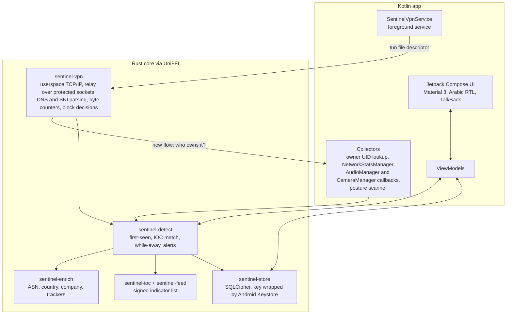

# Phase A — Sentinel for Android

Version 0.1 · Oct 2026 · Status: **Proposed** · Part of [PLAN.md](PLAN.md)

A free Android app that shows every connection each app makes, where the data goes, when apps use the microphone or camera, and whether the phone shows known signs of stalkerware or spyware. It needs no root, and it uses no Accessibility API (SRS §2.4).

This is SRS phase P1 ("Android MVP") plus the parts of P2 and §8A that work on the phone itself.

## 1. Why Android first

- Android is the majority platform in most Arabic-speaking countries, which is where our first users are.
- `VpnService` gives real per-app network visibility without root or a kernel driver.
- Distribution is cheap and fast: GitHub releases and F-Droid first, Google Play after its policy reviews.
- Most of the Rust core built here (storage, indicators, signed feed, enrichment, detection) is reused by every later edition.

**What on-device checking cannot do** (SRS §8A): spyware that controls the whole phone can hide from any app running on that phone. Phase A therefore says "Known traces found" or "No known traces found", never "safe", and points users to an outside check. That outside check, a PC that examines the phone, is Phase B.

## 2. Scope

### Must (Phase A gate)

| Area | SRS IDs | What the user gets |
| --- | --- | --- |
| Connections | CM-01, CM-02, CM-03 | Every TCP, UDP and QUIC flow per app, with hostname (from DNS or SNI) and bytes; live view grouped by app |
| New behaviour | CM-04, CM-06 | Alert on an app's first network use and on new destinations; separate "while screen off" traffic per app |
| Network changes | CM-07 (Android subset) | Alert when Private DNS, proxy or VPN state changes |
| Blocking | CM-08 (Monitor, Block unknown), CM-10 (app, domain, IP), RA-01, RA-03 | Block an app, a destination or a company; one-tap isolation |
| Where data goes | DT-01, DT-02, DT-06 | Company, category and country per destination, with confidence and source; known tracker SDKs per app |
| Sensors (basic) | SE-01 (basic), SE-03, SE-04 | Mic and camera in use, with the foreground app as a best guess; alert when used with the screen off |
| Device posture | ID-03, ID-10, ID-12 | Wireless ADB on; user-installed CA certificates; apps with accessibility, device-admin or notification-listener access |
| Stalkerware and spyware | ID-13, MS-02 (Android), MS-10, MS-12, MS-13, MS-15 | Installed apps and network traffic matched against a signed indicator list; past traffic re-checked when the list updates; hardening checklist; MS-13 advice on every match |
| Alerts | AL-01 to AL-06 | Four severities, plain language, grouping and rate limits, Do Not Disturb respected, Android notification channels |
| Data | §13, §13.2 | Encrypted local database; default retention; one-tap wipe |
| Language and access | §12.4, NF-14 | English and Arabic with RTL; TalkBack; large text; high contrast |
| Quality | NF-03, NF-04, NF-07, NF-11, SP-03 | ≤ 3% battery per day; ≤ 5 ms p95 added latency; fails open; no telemetry; monitoring gaps recorded and shown |

### Should (if time allows; otherwise early in the next phase)

- Behaviour detection: upload baselines (DL-02), beacon-like traffic (DL-04), DNS anomalies (DL-05), uploads to file-sharing and paste sites (DL-06).
- Exact sensor attribution after an ADB grant (SE-01 exact), if the A0 spike confirms it works.
- Lockdown mode (CM-08).
- Export of flows and alerts to JSON and CSV (§12.3).
- SNI from QUIC Initial packets.

### Not in Phase A

- DL-01 (needs the missing product-spec inference table, AM-05).
- Certificate checks, traceroute, Sankey and map views (DT-04, DT-05, DT-08).
- Android TV (planned to reuse this app later).
- Automatic actions beyond firewall decisions (SRS §9 rules).

## 3. Platform facts that shape the design

| Fact | Consequence |
| --- | --- |
| Android allows one active VPN at a time | Users with a commercial VPN cannot run Sentinel alongside it. Shown on first run (AM-09). |
| With Private DNS on, DNS goes encrypted through the tunnel | Hostnames then come from SNI; the app suggests turning Private DNS off or setting it to automatic, and explains why. |
| Some system traffic bypasses the VPN | Shown as a known gap in the app (SRS §2.2). |
| A normal app cannot see which app holds the mic; camera availability callbacks do not name the app | Basic mode shows "in use" plus the foreground app as an approximate guess, clearly labelled. |
| A normal app cannot revoke another app's permissions or turn off wireless ADB | RA-04 and RA-10 become guided actions that open the right settings screen (AM-15). |
| Listing all installed apps needs `QUERY_ALL_PACKAGES`, which Google Play restricts | Needed for ID-12 and ID-13; requires a Play policy declaration (AM-14). No issue on F-Droid. |
| Some manufacturers kill background services aggressively | Guided battery-optimisation steps per brand; heartbeat records gaps (SP-03). |
| If our VPN service dies, Android sends traffic outside the tunnel | This matches "fail open" (NF-07); the gap is recorded and shown. |

Targets: `minSdk` 29 (Android 10, needed for `getConnectionOwnerUid`), `targetSdk` at the level Google Play requires at release time. Test devices: Android 10, 12, 14 and the latest version, including at least one Samsung and one Xiaomi phone.

## 4. Architecture

Key points:

- The packet engine runs in Rust and receives the tun file descriptor from `VpnService`. Outgoing sockets are protected with `VpnService.protect()`, so they bypass our own tunnel.
- For each new flow, Rust calls back into Kotlin, which uses `ConnectivityManager.getConnectionOwnerUid` to find the owning app. This happens once per flow, not per packet.
- We never read or store payloads. Only the first packets' DNS and TLS/QUIC handshake metadata are parsed (SRS §2.5).
- The database key is random, encrypted by a key that lives in the Android Keystore, and never written in plain form.

## 5. Indicator data

| Data | Candidate source | Use |
| --- | --- | --- |
| Stalkerware: package names, signing certificates, domains, IPs | Echap `stalkerware-indicators` | ID-13 |
| Mercenary spyware: domains, IPs | Amnesty `mvt-indicators`, Citizen Lab `malware-indicators` | ID-13, MS-02 |
| Trackers and SDKs | Exodus Privacy signatures, DuckDuckGo Tracker Radar | DT-06 |
| IP to ASN, country | Public-domain IP-to-ASN data, DB-IP Lite (CC BY 4.0) | DT-01 |

Every source passes the A0 licence review before it ships. The signed-feed format, signing and update process are as described in [PHASE-B-PHONE-CHECK.md §4](PHASE-B-PHONE-CHECK.md#4-indicator-feed-ms-10). The same feed serves every edition.

## 6. Sprint plan

Two-week sprints, team of about 3: Rust engine, Android and UI, and detection and data. Every task names its SRS ID; tasks become GitHub issues.

### A0 — Foundations (weeks 1–2)

- [ ] Owner decisions D1–D8 from [PLAN.md §8](PLAN.md#8-decisions-needed-from-the-project-owners). D2 (GPL) and D4 (name kept for now) are decided; D1, D3, D5–D8 are open
- [x] Licence review, desk part: [LICENCE-REVIEW.md](LICENCE-REVIEW.md)
- [ ] Licence review, confirmations L1–L3 with the data maintainers (before Sprints 4 and 7)
- [x] **Spike 1: packet engine (host part).** Rust engine built on `ipstack` and `smoltcp`, measured in a Linux lab that CI runs on every push. Decision in A0: Rust engine on a patched `ipstack`; revised in Sprint 1 to smoltcp, because ipstack has no flow control ([ADR-0006](adr/0006-android-packet-engine.md)).
- [ ] **Spike 1: packet engine (phone part).** Measure latency, battery, throughput and memory on a real phone once Spike 2 can start the tunnel (ADR-0006, "Still open").
- [x] **Spike 2: build pipeline.** UniFFI bindings and `cargo-ndk` builds for arm64-v8a, armeabi-v7a and x86_64 inside Gradle (AGP 9.4, built-in Kotlin, Compose). CI builds the APK, runs lint, and runs `CoreBindingTest` on an Android 14 emulator, which loads the Rust library and calls it ([ANDROID-BUILD.md](ANDROID-BUILD.md))
- [ ] F-Droid: confirm F-Droid's build server can build the app from source (Rust toolchain, cargo-ndk, Gradle wrapper)
- [ ] **Spike 3: sensors.** What basic mode can see on Android 10 to the latest version, and whether an ADB-granted `GET_APP_OPS_STATS` gives exact per-app history. Test plan ready ([SPIKE-3-SENSORS.md](SPIKE-3-SENSORS.md)); needs real phones, so it runs in Sprint 1
- [x] **Spike 4: feed signing.** Decided: a small DSSE-signed manifest, not TUF yet ([ADR-0005](adr/0005-signed-feed-format.md)). Implemented in `crates/sentinel-feed` and `tools/feed-tool`; procedure in [FEED-SIGNING.md](FEED-SIGNING.md).
- [x] Repo setup: Cargo workspace, Gradle project, CI (cargo fmt, clippy, test, `cargo deny`, engine lab; Android build, lint, emulator tests). Still to add: ktlint or detekt
- [x] Phase A threat model (STRIDE): [THREAT-MODEL-A.md](THREAT-MODEL-A.md)
- [ ] Wireframes for every screen, in Arabic and English
- [x] Google Play policy review: [PLAY-POLICY.md](PLAY-POLICY.md)
- [x] `SECURITY.md` (vulnerability disclosure). The repository owner must turn on private vulnerability reporting in the GitHub settings

### Sprint 1 — Tunnel that works

- [ ] VPN consent flow, foreground service and persistent notification (§15.3: always visible)
- [ ] Rust engine: TCP and UDP relay over protected sockets, IPv4 and IPv6, DNS forwarding. Done so far: engine start and stop over FFI with tunnel-closure detection, UDP over IPv4 and IPv6 tested without root, smoltcp as the default stack with flow control and no idle polling, ipstack half-close fixed. Still to do: IPv6 in the lab
- [ ] Fail open and record a gap when the engine stops (NF-07, SP-03)
- [ ] Benchmarks in CI and on one real phone: latency (NF-04) and battery (NF-03), tracked every sprint from now on

### Sprint 2 — Flows and storage

- [ ] Flow tracking with owner UID, endpoints, protocol, start and end, bytes up and down (CM-01)
- [ ] DNS answer cache and TLS SNI parsing; hostname and its source per flow (CM-02)
- [ ] `sentinel-store`: SQLCipher schema from SRS §13, Keystore-wrapped key, retention and roll-up (§13.2), one-tap wipe
- [ ] Test: 100% of flows in the test suite recorded within 1 s (CM-01 criterion)

### Sprint 3 — Live view

- [ ] Connections screen grouped by app, refreshed every second, smooth at 500 concurrent flows (CM-03)
- [ ] App detail: destinations, data sent, first seen
- [ ] "While screen off" counters (CM-06)
- [ ] Arabic and English strings, RTL check on every screen

### Sprint 4 — Where data goes

- [ ] `sentinel-enrich`: offline ASN, country, company and category lookup in under 1 ms per flow (DT-01)
- [ ] "Why we believe this" source and confidence on every destination card (DT-02)
- [ ] Tracker and SDK matching per app (DT-06)

### Sprint 5 — Alerts

- [ ] Alert framework: four severities, title, one-sentence explanation, evidence, actions (AL-01, AL-02)
- [ ] Grouping, rate limits, Do Not Disturb, notification channels (AL-03, AL-04, AL-06)
- [ ] "Not useful" and allow-list feedback, stored locally (AL-05)
- [ ] First-ever network use and first-seen destinations (CM-04); Private DNS, proxy and VPN changes (CM-07)

### Sprint 6 — Blocking

- [ ] Rules by app, domain and IP (CM-10 subset); rule-engine unit tests for each field
- [ ] Monitor and Block-unknown modes, switching within 1 s (CM-08)
- [ ] Block from an alert or the app detail screen (RA-01); one-tap isolation (RA-03)
- [ ] Every action journalled with undo (SRS §9 rules)

### Sprint 7 — Indicators and retro-hunt

- [ ] Signed feed: download over HTTPS, verify signature, version, expiry and provenance, or import from a file (MS-10)
- [ ] Match DNS lookups and flows against indicators; planted test indicator alerts within 5 s (ID-13)
- [ ] Re-check stored history when the feed updates and report past matches with dates (MS-02)
- [ ] Result wording and advice on every match (MS-13, MS-15)

### Sprint 8 — Posture, stalkerware, sensors

- [ ] Installed apps checked against stalkerware package names and signing certificates (ID-13)
- [ ] Accessibility, device-admin and notification-listener access by apps not on the allow list (ID-12)
- [ ] Wireless ADB (ID-03) and user-installed CA certificates (ID-10)
- [ ] Hardening checklist with current status where readable: Android Advanced Protection, updates, unknown sources (MS-12)
- [ ] Basic mic and camera monitoring, in-use notification, screen-off alert (SE-01 basic, SE-03, SE-04)

### Sprint 9 — Hardening and "should" items

- [ ] Performance and battery tuning to meet NF-03 and NF-04 on the reference phones
- [ ] Cap on concurrent flows per app and in total (THREAT-MODEL-A D2)
- [ ] Per-brand battery-optimisation guidance; heartbeat and gap display (SP-03)
- [ ] Should items, in order: DL-04, DL-05, JSON/CSV export, DL-02, DL-06

### Sprint 10 — Release readiness

- [ ] TalkBack, large text, high contrast pass
- [ ] Arabic copy review by native speakers; plain-language check (AL-02)
- [ ] Usability sessions: 8 users, at least half Arabic-first; first-run setup in under 5 minutes (NF-12)
- [ ] Threat-model review; fuzz the DNS, TLS and QUIC parsers
- [ ] Signed release on GitHub; F-Droid submission
- [ ] Public beta

## 7. Risks and fallbacks

| Risk | Fallback |
| --- | --- |
| The Rust packet engine is slow or unstable | Reuse a proven C engine under GPL (decided in the A0 spike); or ship a DNS-only mode first |
| Battery use above 3% per day | Measure from Sprint 1; batch database writes; reduce detail on low battery (DV-02) |
| Manufacturers kill the service | Brand-specific guidance, always-on VPN instructions, visible gap records |
| Google Play rejects the VPN or package-visibility use | GitHub and F-Droid are the primary channels anyway; fix and resubmit |
| Basic sensor monitoring cannot name the app | Label it as approximate; offer exact mode through ADB if Spike 3 succeeds |
| Users read "No known traces found" as "safe" | MS-15 wording, §8A.3 limits on every such result, partner review, Phase B outside check |

## 8. Definition of done for Phase A

SRS P1 gate: public beta and audit 1. The audit happens if funding allows (see SUSTAINABILITY.md).

- CM-01: 100% of test-suite flows recorded within 1 s. CM-03: live view smooth at 500 concurrent flows.
- NF-04 ≤ 5 ms p95 added latency; NF-03 ≤ 3% battery per day on the reference phones.
- A planted indicator alerts within 5 s; a past record matches after a feed update (MS-02).
- A stalkerware test package is detected (ID-13).
- A tampered feed is rejected (MS-10).
- Every result screen passes the MS-15 and §8A.3 copy review in both languages.
- Anti-abuse checklist (SRS §15.3) signed off: visible notification, no content capture, no remote features.
