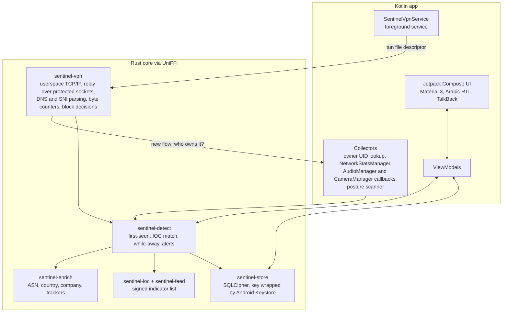

# Phase A — Sentinel for Android

Version 0.1 · Oct 2026 · Status: **Proposed** · Part of [PLAN.md](PLAN.md)

A free Android app that shows every connection each app makes, where the data goes, when apps use the microphone or camera, and whether the phone shows known signs of stalkerware or spyware. It needs no root, and it uses no Accessibility API (SRS §2.4).

This is SRS phase P1 ("Android MVP") plus the parts of P2 and §8A that work on the phone itself.

## 1. Why Android first

- Android is the majority platform in most Arabic-speaking countries, which is where our first users are.
- `VpnService` gives real per-app network visibility without root or a kernel driver.
- Distribution is cheap and fast: GitHub releases and F-Droid first, Google Play after its policy reviews.
- Most of the Rust core built here (storage, indicators, signed feed, enrichment, detection) is reused by every later edition.

**What on-device checking cannot do** (SRS §8A): spyware that controls the whole phone can hide from any app running on that phone. Phase A therefore says "Known traces found" or "No known traces found", never "safe", and points users to an outside check. That outside check, a PC that examines the phone, is Phase B.

## 2. Scope

### Must (Phase A gate)

| Area | SRS IDs | What the user gets |
| --- | --- | --- |
| Connections | CM-01, CM-02, CM-03 | Every TCP, UDP and QUIC flow per app, with hostname (from DNS or SNI) and bytes; live view grouped by app |
| New behaviour | CM-04, CM-06 | Alert on an app's first network use and on new destinations; separate "while screen off" traffic per app |
| Network changes | CM-07 (Android subset) | Alert when Private DNS, proxy or VPN state changes |
| Blocking | CM-08 (Monitor, Block unknown), CM-10 (app, domain, IP), RA-01, RA-03 | Block an app, a destination or a company; one-tap isolation |
| Where data goes | DT-01, DT-02, DT-06 | Company, category and country per destination, with confidence and source; known tracker SDKs per app |
| Sensors (basic) | SE-01 (basic), SE-03, SE-04 | Mic and camera in use, with the foreground app as a best guess; alert when used with the screen off |
| Device posture | ID-03, ID-10, ID-12 | Wireless ADB on; user-installed CA certificates; apps with accessibility, device-admin or notification-listener access |
| Stalkerware and spyware | ID-13, MS-02 (Android), MS-10, MS-12, MS-13, MS-15 | Installed apps and network traffic matched against a signed indicator list; past traffic re-checked when the list updates; hardening checklist; MS-13 advice on every match |
| Alerts | AL-01 to AL-06 | Four severities, plain language, grouping and rate limits, Do Not Disturb respected, Android notification channels |
| Data | §13, §13.2 | Encrypted local database; default retention; one-tap wipe |
| Language and access | §12.4, NF-14 | English and Arabic with RTL; TalkBack; large text; high contrast |
| Quality | NF-03, NF-04, NF-07, NF-11, SP-03 | ≤ 3% battery per day; ≤ 5 ms p95 added latency; fails open; no telemetry; monitoring gaps recorded and shown |

### Should (if time allows; otherwise early in the next phase)

- Behaviour detection: upload baselines (DL-02), beacon-like traffic (DL-04), DNS anomalies (DL-05), uploads to file-sharing and paste sites (DL-06).
- Exact sensor attribution after an ADB grant (SE-01 exact), if the A0 spike confirms it works.
- Lockdown mode (CM-08).
- Export of flows and alerts to JSON and CSV (§12.3).
- SNI from QUIC Initial packets.

### Not in Phase A

- DL-01 (needs the missing product-spec inference table, AM-05).
- Certificate checks, traceroute, Sankey and map views (DT-04, DT-05, DT-08).
- Android TV (planned to reuse this app later).
- Automatic actions beyond firewall decisions (SRS §9 rules).

## 3. Platform facts that shape the design

| Fact | Consequence |
| --- | --- |
| Android allows one active VPN at a time | Users with a commercial VPN cannot run Sentinel alongside it. Shown on first run (AM-09). |
| With Private DNS on, DNS goes encrypted through the tunnel | Hostnames then come from SNI; the app suggests turning Private DNS off or setting it to automatic, and explains why. |
| Some system traffic bypasses the VPN | Shown as a known gap in the app (SRS §2.2). |
| A normal app cannot see which app holds the mic; camera availability callbacks do not name the app | Basic mode shows "in use" plus the foreground app as an approximate guess, clearly labelled. |
| A normal app cannot revoke another app's permissions or turn off wireless ADB | RA-04 and RA-10 become guided actions that open the right settings screen (AM-15). |
| Listing all installed apps needs `QUERY_ALL_PACKAGES`, which Google Play restricts | Needed for ID-12 and ID-13; requires a Play policy declaration (AM-14). No issue on F-Droid. |
| Some manufacturers kill background services aggressively | Guided battery-optimisation steps per brand; heartbeat records gaps (SP-03). |
| If our VPN service dies, Android sends traffic outside the tunnel | This matches "fail open" (NF-07); the gap is recorded and shown. |

Targets: `minSdk` 29 (Android 10, needed for `getConnectionOwnerUid`), `targetSdk` at the level Google Play requires at release time. Test devices: Android 10, 12, 14 and the latest version, including at least one Samsung and one Xiaomi phone.

## 4. Architecture

Key points:

- The packet engine runs in Rust and receives the tun file descriptor from `VpnService`. Outgoing sockets are protected with `VpnService.protect()`, so they bypass our own tunnel.
- For each new flow, Rust calls back into Kotlin, which uses `ConnectivityManager.getConnectionOwnerUid` to find the owning app. This happens once per flow, not per packet.
- We never read or store payloads. Only the first packets' DNS and TLS/QUIC handshake metadata are parsed (SRS §2.5).
- The database key is random, encrypted by a key that lives in the Android Keystore, and never written in plain form.

## 5. Indicator data

| Data | Candidate source | Use |
| --- | --- | --- |
| Stalkerware: package names, signing certificates, domains, IPs | Echap `stalkerware-indicators` | ID-13 |
| Mercenary spyware: domains, IPs | Amnesty `mvt-indicators`, Citizen Lab `malware-indicators` | ID-13, MS-02 |
| Trackers and SDKs | Exodus Privacy signatures, DuckDuckGo Tracker Radar | DT-06 |
| IP to ASN, country | Public-domain IP-to-ASN data, DB-IP Lite (CC BY 4.0) | DT-01 |

Every source passes the A0 licence review before it ships. The signed-feed format, signing and update process are as described in [PHASE-B-PHONE-CHECK.md §4](PHASE-B-PHONE-CHECK.md#4-indicator-feed-ms-10). The same feed serves every edition.

## 6. Sprint plan

Two-week sprints, team of about 3: Rust engine, Android and UI, and detection and data. Every task names its SRS ID; tasks become GitHub issues.

### A0 — Foundations (weeks 1–2)

- [ ] Owner decisions D1–D8 from [PLAN.md §8](PLAN.md#8-decisions-needed-from-the-project-owners). D2 (GPL) and D4 (name kept for now) are decided; D1, D3, D5–D8 are open
- [x] Licence review, desk part: [LICENCE-REVIEW.md](LICENCE-REVIEW.md)
- [ ] Licence review, confirmations L1–L3 with the data maintainers (before Sprints 4 and 7)
- [x] **Spike 1: packet engine (host part).** Rust engine built on `ipstack` and `smoltcp`, measured in a Linux lab that CI runs on every push. Decision in A0: Rust engine on a patched `ipstack`; revised in Sprint 1 to smoltcp, because ipstack has no flow control ([ADR-0006](adr/0006-android-packet-engine.md)).
- [ ] **Spike 1: packet engine (phone part).** Measure latency, battery, throughput and memory on a real phone once Spike 2 can start the tunnel (ADR-0006, "Still open").
- [x] **Spike 2: build pipeline.** UniFFI bindings and `cargo-ndk` builds for arm64-v8a, armeabi-v7a and x86_64 inside Gradle (AGP 9.4, built-in Kotlin, Compose). CI builds the APK, runs lint, and runs `CoreBindingTest` on an Android 14 emulator, which loads the Rust library and calls it ([ANDROID-BUILD.md](ANDROID-BUILD.md))
- [ ] F-Droid: confirm F-Droid's build server can build the app from source (Rust toolchain, cargo-ndk, Gradle wrapper)
- [ ] **Spike 3: sensors.** What basic mode can see on Android 10 to the latest version, and whether an ADB-granted `GET_APP_OPS_STATS` gives exact per-app history. Test plan ready ([SPIKE-3-SENSORS.md](SPIKE-3-SENSORS.md)); needs real phones, so it runs in Sprint 1
- [x] **Spike 4: feed signing.** Decided: a small DSSE-signed manifest, not TUF yet ([ADR-0005](adr/0005-signed-feed-format.md)). Implemented in `crates/sentinel-feed` and `tools/feed-tool`; procedure in [FEED-SIGNING.md](FEED-SIGNING.md).
- [x] Repo setup: Cargo workspace, Gradle project, CI (cargo fmt, clippy, test, `cargo deny`, engine lab; Android build, lint, emulator tests). Still to add: ktlint or detekt
- [x] Phase A threat model (STRIDE): [THREAT-MODEL-A.md](THREAT-MODEL-A.md)
- [ ] Wireframes for every screen, in Arabic and English
- [x] Google Play policy review: [PLAY-POLICY.md](PLAY-POLICY.md)
- [x] `SECURITY.md` (vulnerability disclosure). The repository owner must turn on private vulnerability reporting in the GitHub settings

### Sprint 1 — Tunnel that works

- [x] VPN consent flow, foreground service and persistent notification (§15.3: always visible). Tested end to end on an Android 14 emulator in CI ([ADR-0008](adr/0008-android-tunnel-setup.md))
- [x] Rust engine: TCP and UDP relay over protected sockets, IPv4 and IPv6, DNS forwarding. smoltcp as the default stack with flow control and no idle polling ([ADR-0006](adr/0006-android-packet-engine.md)); DNS forwarded to the current network's resolvers ([ADR-0008](adr/0008-android-tunnel-setup.md)); IPv4 and IPv6 checked in the CI lab and without root
- [x] Fail open and record a gap when the engine stops (NF-07, SP-03): engine failure, VPN revoked or taken over, tunnel not opened, process killed or crashed. Tested: the gap file, and that a stop the user asked for is not a gap. Not yet tested on a device: the revoke and process-exit paths (Sprint 9 hardening)
- [ ] Benchmarks in CI and on one real phone: latency (NF-04) and battery (NF-03), tracked every sprint from now on. The host lab runs in CI; the phone part needs a real phone (ADR-0006, "Still open")

### Sprint 2 — Flows and storage

- [x] Flow tracking with owner UID, endpoints, protocol, start and end, bytes up and down (CM-01). The engine reports each flow when it starts and when it ends, with the owner from `getConnectionOwnerUid`; flows still open when the engine stops are ended with their byte counts. Stored in the encrypted history below
- [x] DNS answer cache and TLS SNI parsing; hostname and its source per flow (CM-02). In the engine since A0; now carried to the app in every flow record
- [x] `sentinel-store`: SQLCipher schema from SRS §13, Keystore-wrapped key, retention and roll-up (§13.2), one-tap wipe ([ADR-0009](adr/0009-local-history-store.md)). The engine writes every flow into it; gaps live there too
- [x] Test: 100% of flows in the test suite recorded within 1 s (CM-01 criterion). In the engine: 200 flows, each reported with its owner within 1 s and all 200 stored (the test fails if the batch delay is raised to 1.5 s). On the Android 14 emulator in CI: 20 connections in a row, each recorded with its app within 1 s of being opened, all 20 in the encrypted history

### Sprint 3 — Live view

- [x] Connections screen grouped by app, refreshed every second, smooth at 500 concurrent flows (CM-03). The engine groups its open flows by app with live byte counts and the five busiest destinations; the screen refreshes every second, only while it is on screen. On the Android 14 emulator in CI: 500 connections held open at once all show under their app within 1 s, a refresh at that load stays under 50 ms (90th percentile of 50 refreshes), and the list renders 500 app rows and scrolls to the last. Frame timing on a real phone belongs with the phone benchmarks
- [x] App detail: destinations, data sent, first seen. Opens from the live view or a recent connection; reads the encrypted history, daily roll-ups included, with each destination's connections, bytes sent and received, and last seen, most data sent first. Data of a connection still open is added when it ends, and the screen says so. On the Android 14 emulator in CI: three requests through the tunnel are totalled to the byte under this app, and tapping a live row opens its app
- [x] "While screen off" counters (CM-06). The user counts as away while the screen is off or the lock screen shows; every byte relayed meanwhile is also counted apart in its flow, so a connection that spans both is split exactly. Stored per flow and per daily total (schema 3); the main screen lists apps that carried data while away in the last 24 hours, and the app detail screen shows the app's and each destination's away totals. On the Android 14 emulator in CI: with the screen turned off between requests, exactly the request sent while it was off counts as away
- [x] Arabic and English strings, RTL check on every screen. Every Arabic string starts with an Arabic word, and values put into sentences (app names, hostnames, addresses, error messages) are wrapped in Unicode isolates, so lines that carry Latin names stay right to left. On the Android 14 emulator in CI: `StringsTest` checks the direction of every string and Arabic plural form; `RtlTest` renders the main, live and app detail screens in Arabic and checks Arabic text and plurals, right-edge placement and right-to-left sentences. Still to do before release: review of the Arabic wording by a native speaker (CONTRIBUTING.md)

### Sprint 4 — Where data goes

- [x] `sentinel-enrich`: offline ASN, country, company and category lookup in under 1 ms per flow (DT-01). Network (ASN), its owner and approximate country from IPtoASN and DB-IP Lite, in a checked range-table file ([ADR-0010](adr/0010-offline-ip-enrichment.md)): 0.56 µs per lookup at 1.3 million ranges (release build, synthetic data). Company and category from DuckDuckGo's tracker lists, in a checked domain-table file ([ADR-0011](adr/0011-tracker-list.md)): 2.6 µs per lookup at 300,000 domains (release build, synthetic); the real lists give 9,324 domains in 416 KB. Both ship through the feed, and every flow record carries their answers once the app sets the files. Still to measure before Sprint 7 ships the IP file: its size with the real data sets
- [x] "Why we believe this" source and confidence on every destination card (DT-02). Each destination card on the app detail screen says how its name was learned (TLS server name, DNS answer, or address only), its network and owner, and its approximate country, each with its source and date and how far to trust it. Stored in the SRS `destination` table (history schema 4). On the Android 14 emulator in CI: with a small IP database installed, a request to the test server is stored with AS64500, its owner, Jordan and both sources; every line of a card is shown, in Arabic right to left. Confidence is given in words, not as the SRS `confidence` number; company and category join the cards with DT-06
- [x] Tracker and SDK matching per app (DT-06). The tracker list ([ADR-0011](adr/0011-tracker-list.md)) gives each named destination its company and kind of service, each with the list and entry it comes from; the history keeps them (schema 5), and the app detail screen shows them on each destination card and adds up the companies of all of an app's destinations. On the Android 14 emulator in CI: with a small tracker list installed, a connection whose TLS ClientHello names `pixel.g.ads.sentinel.test` is stored with the company from the app list test data and the categories from the Tracker Radar test data; the cards and the companies section are shown in English and in Arabic right to left (24 device tests, none skipped). SDK names (Exodus Privacy) wait for LICENCE-REVIEW L2; app-only trackers are covered only by DuckDuckGo's app list, last updated July 2023

### Sprint 5 — Alerts

- [x] Alert framework: four severities, title, one-sentence explanation, evidence, actions (AL-01, AL-02). `sentinel-detect` holds the alert model (rule, severity, evidence, actions); alerts are kept in the history (schema 6) and the app writes their text in the user's language ([ADR-0012](adr/0012-alerts.md)). The first rule raises a Warning when monitoring stops without the user asking (SP-03). On the Android 14 emulator in CI: a recorded gap raises one alert; the detail screen shows severity, title, explanation, evidence, then actions, in English and in Arabic right to left; the four severities have four different colours and names; the English alert texts read at grade 8 or lower (Flesch-Kincaid). Distinct sounds per severity come with the notification channels (next item)
- [x] Grouping, rate limits, Do Not Disturb, notification channels (AL-03, AL-04, AL-06). One channel per severity with its own importance, sound and vibration; the core decides each notification (at most three non-critical an hour per app, Info and Warning wait during Do Not Disturb) and records it atomically; repeated alerts share one notification; on a locked phone a notification sounds but shows nothing ([ADR-0012](adr/0012-alerts.md)). AL-03's load test in the core: one alert a second for two hours gives three notifications each hour. On the Android 14 emulator in CI: the channels, a gap's Warning notification, five gaps giving one notification with three notified, and a Warning held during Do Not Disturb (37 device tests, none skipped). Letting High and Critical through Do Not Disturb needs the user's permission in Android's settings; a guide comes with the settings screen
- [x] "Not useful" and allow-list feedback, stored locally (AL-05). Every alert asks whether it was useful. "Not useful" keeps later alerts like it in the app without a notification; "allow" stops the rule for that app. Both can be undone, and a Critical alert cannot be allowed or silenced ([ADR-0012](adr/0012-alerts.md)). Kept in the encrypted history (schema 8) and never sent anywhere. On the Android 14 emulator in CI: allowing a gap alert stops the next one until undone, and the feedback buttons, their results and Undo work in English and in Arabic right to left (39 device tests, none skipped). A list of everything allowed comes with the settings screen
- [x] First-ever network use and first-seen destinations (CM-04). Two Info rules ([ADR-0013](adr/0013-first-seen.md)). An app installed after the history began raises one alert when it first connects, naming where it went; apps already installed when Sentinel started, and Android's shared system identities, raise none. After a week of learning an app, the names it connects to for the first time raise one alert a day, which lists up to 20 and counts the rest; connections known only by their address are never flagged. The history keeps when it began and each app's names (schema 9). In the core: through the real packet engine, a newly installed app's first connection raises one alert. On the Android 14 emulator in CI: install times come from the package manager; right after a wipe, Sentinel's own connections raise no "new app" alert; both rules are shown with their places in English and in Arabic right to left (43 device tests, none skipped). The positive case on a device needed a second test app installed during the test, so it was covered in the core; since Sprint 6, `FirewallModeTest` covers it on the emulator with the probe app
- [x] Private DNS, proxy and VPN changes (CM-07). Three Warning rules ([ADR-0014](adr/0014-network-settings.md)), each showing the setting before and after and offering Android's network settings. The DNS servers count when they change on the network in use. Private DNS counts when its named provider changes. The proxy counts when the phone's proxy changes, or the network's own proxy changes while on it. Joining another network is not a change. The last state is kept in the history (schema 10), so a change made while Sentinel was off is found when it runs again. VPN state was already covered: another VPN taking over stops monitoring and raises "monitoring stopped". The hosts file (read-only without root) and network profile (not an Android setting) are not watched. On the Android 14 emulator in CI: setting a proxy for the whole phone, and naming a Private DNS provider, each raise their alert within 5 s (under 1 s measured); both are shown in English and in Arabic right to left (47 device tests, none skipped). DNS server changes are covered by the core's tests, since the emulator's network cannot change them

### Sprint 6 — Blocking

- [x] Rules by app, domain and IP (CM-10 subset); rule-engine unit tests for each field. A rule names an app, a destination (a domain and the names below it, or an address range), or both, and allows or blocks; the most specific rule decides and blocking wins a tie ([ADR-0015](adr/0015-firewall-rules.md)). The core decides and the engine asks at three moments, each with only what it knows for sure: a new connection (app and address), its TLS server name, and a DNS lookup through the tunnel, which a blocked name answers with "no such name". A name learned only from an earlier DNS answer is never matched, because many sites share addresses. Rules are kept in the encrypted history (schema 11), and blocked connections are stored as blocked. Rule-engine tests cover each field and each rule of decision. On the Android 14 emulator in CI: an address rule stops this app's request five times over, with monitoring restarted in between, and lets it through once removed; a domain rule stops a TLS connection by its server name; a domain rule makes the tunnel's resolver answer "no such name" (50 device tests, none failed). Company, country, port and direction rules come later
- [x] Monitor and Block-unknown modes, switching within 1 s (CM-08). Two modes on the main screen ([ADR-0016](adr/0016-firewall-modes.md)): Watch only, the default, blocks only what the user's rules block; Block new apps blocks the apps installed after it was turned on until a rule allows them. Apps installed before, Sentinel itself, and connections without an app or install time (Android's shared system identities) are never stopped by the mode. Rules decide first, the mode only where none matches. The mode and when it was turned on are kept in the history (schema 12) and held in memory beside the rules, so a switch applies to the next connection. A blocked new app's first connection raises the "new app" alert saying it was blocked, with "Let it use the internet", which keeps a rule allowing the app. On the Android 14 emulator in CI, with a second app installed during the test (the probe): with Block new apps on, Sentinel's own request gets through and the probe is stopped and stored as blocked, with the alert offering to allow it; allowing it lets it through; Watch only lets it through at once; turning Block new apps on again counts from then; each switch returns in well under a second. The alert and the mode choice are shown in English and in Arabic right to left (54 device tests, none skipped). Lockdown, a list of allowed apps and undo come later
- [x] Block from an alert or the app detail screen (RA-01); one-tap isolation (RA-03). The app detail screen says whether the app may use the internet and why not (a rule, or Block new apps), and offers the one change that fits: block it, take the block back, or allow a new app. Each destination can be blocked for that app, and each company the tracker list names among its destinations can be blocked in every app (company rules, [ADR-0015](adr/0015-firewall-rules.md)). The "new app" and "new places" alerts offer to block the app. A rule change, a mode switch or isolation now ends open connections that are no longer allowed: the engine decides every open flow again ([ADR-0015](adr/0015-firewall-rules.md)). Isolation ([ADR-0017](adr/0017-isolation.md)) leaves the internet to DNS, Sentinel itself and the apps a rule allows as a whole, takes effect at once, and is kept in the history (schema 13) until the user ends it from the banner on the main screen. Fixed on the way: a connection whose server closed first stayed open for 10 s (smoltcp's TIME_WAIT); `third_party/netstack-smoltcp` patch 2 ends it at once, and the lab now fails if such a flow takes over 2 s. On the Android 14 emulator in CI: blocking this app from its screen stops its connections and taking the block back lets them through; a rule made while a connection is open ends it; isolating takes under a second, Sentinel's own request and DNS still get through, the probe does not, also after monitoring restarts, until a rule allows it or isolation ends; the main screen isolates and ends isolation with one tap each; the new controls, alert and banner are shown in English and in Arabic right to left (59 device tests, none skipped). Undo through the action journal comes next
- [x] Every action journalled with undo (SRS §9 rules). Each change to the firewall (a rule kept or taken back, the mode, isolation) is written together with its journal entry: the setting before and after, when, who, and the alert it was taken from ([ADR-0018](adr/0018-action-journal.md), schema 14, the SRS `action_journal` table). A change that changes nothing is not journalled. Undo puts the setting back exactly, the times Block new apps and isolation began included, for open connections too, and only while the setting is still as the action left it; otherwise it is refused and nothing changes. "Your actions" on the main screen lists the journal, newest first, with Undo where it applies and what each Undo did. On the Android 14 emulator in CI: blocking this app from an alert is journalled with that alert, and Undo on the journal screen lets its request through again; after switching to Block new apps, isolating and ending isolation, Undo is offered on the latest action of each setting only, and undoing them newest first brings isolation back with when it began, ends it, and returns to Watch only; each kind of action is described in one sentence, in English and in Arabic right to left (63 device tests, none skipped). Retention of the journal (one year, SRS §13.2) comes with Sprint 9

### Sprint 7 — Indicators and retro-hunt

- [x] Signed feed: download over HTTPS, verify signature, version, expiry and provenance, or import from a file (MS-10). Indicator files, one per source, give every indicator its source, date and report link ([ADR-0019](adr/0019-indicator-feed-on-android.md), `crates/sentinel-ioc`); one without them, or with a value not written its one way, refuses the whole list, and local or private addresses are refused. A manifest is judged before anything it lists is fetched; a list comes into force in one step, only once its signature, version, expiry, every file's SHA-256 and every indicator's provenance pass where it will be used, and a crash leaves the old or the new list, never a mix. The list in force is checked again when first opened and every hour while monitoring runs (SP-04), and removed if it fails. The app fetches the newest list over HTTPS from the GitHub release tagged `feed` when it opens (if the last check is over six hours old), every six hours, and on request, sending nothing about the phone; or imports it from a folder. The main screen shows the list's date, version, sources and count, and when it is out of date. The IP database and tracker list arrive in the same list. On the Android 14 emulator in CI, with lists signed by a test key that only debug builds trust: a list is downloaded, then up to date, then updated; an older list, one changed after signing, a file larger than listed and a missing file are each refused and the list in force stays; the request names no phone; a list changed on the phone is removed at the next check; the main screen's texts in English and in Arabic right to left (67 device tests, none skipped). Not yet: the maintainers' signing keys (until then the app says it cannot check lists and uses none), the licence answers from the sources (LICENCE-REVIEW L1, L3), and the tool that builds the list from the sources
- [x] Match DNS lookups and flows against indicators; planted test indicator alerts within 5 s (ID-13). Every DNS query through the tunnel, TLS server name and connection address is matched against the domain and address indicators of the list in force ([ADR-0020](adr/0020-indicator-matching.md)): a domain matches itself and every name below it, an address only itself. A match raises a Critical alert naming the app, what was seen and how, and the indicator's family, threat, source, report date and link. There is one alert per app and indicator while it is open. Nothing is blocked without the user; the alert offers to block the app. A new list is matched as soon as it is installed, and one that fails its hourly check stops matching at once. In the core, a datagram to a listed address raises the alert in under a second through the real packet engine. On the Android 14 emulator in CI, with the signed test list: a lookup of a name under the planted indicator raises the alert within 5 s, about the app, with the indicator's provenance; a TLS connection naming it raises one and still gets its answer; repeats raise nothing more; the alert is shown in Arabic right to left (70 device tests, none skipped). Package names and signing certificates are matched against installed apps in Sprint 8; the advice and result wording are the next tasks (MS-13, MS-15)
- [x] Re-check stored history when the feed updates and report past matches with dates (MS-02). When a list comes into force (after an install, and again when monitoring starts should a check have been cut short), the history is checked against it once per list version ([ADR-0021](adr/0021-retro-hunt.md)): every app, name and address it holds connections to, from the last 30 days of flows and from older daily totals. Each app and indicator found raises one Critical alert, "Known traces of spyware found in past traffic", with the number of connections and the days they were made, and the indicator's provenance; anything already reported, live or by an earlier check, open or dismissed, is not raised again. In the core: rolled-up days, kept flows by name and by address, once per version, only new matches from a newer list. On the Android 14 emulator in CI: a TLS connection made with no list in force is found when the signed test list is installed, with its app, name and time; a newer list reports nothing more; the alert is shown in Arabic right to left (72 device tests, none skipped). Not found: lookups that led to no connection (the history keeps no DNS log), and addresses of named connections older than 30 days
- [x] Result wording and advice on every match (MS-13, MS-15). Under the indicator list the main screen says "Known traces found" whenever the history keeps a known-indicator alert, open or dismissed, with how many and the list's date; or "No known traces found" once the history was checked against the list in force, with since when and the list's date, always followed by what such a result cannot say (§8A.3); or that the history was not checked against this list yet ([ADR-0022](adr/0022-result-wording-and-advice.md)). Every known-indicator alert advises, before its actions, not to reset or wipe the phone yet, to move sensitive conversations to another device, and to ask Access Now's Digital Security Helpline or Amnesty International's Security Lab, whose pages it opens and whose addresses it shows. On the Android 14 emulator in CI: every state of the result, the advice and the helpline links, both in Arabic right to left, and no text in either language saying "clean" or "safe" (75 device tests, none skipped). Still to come: the helpline partners' copy review of this wording (MS-15), and services for people watched by a partner rather than for their work

### Sprint 8 — Posture, stalkerware, sensors

- [x] Installed apps checked against stalkerware package names and signing certificates (ID-13). The package and certificate indicators of the list in force are matched against every installed app ([ADR-0023](adr/0023-installed-apps.md)): a package name exactly, a certificate by its SHA-256, taking all of an app's signers, or its current certificate and those it rotated from. Apps are checked when a list comes into force, when monitoring starts, when the app opens, and at once when an app is installed or updated while monitoring runs. A match raises a Critical alert, "Known stalkerware or spyware app found", about the app, with how the indicator was seen, its provenance and the MS-13 advice, and counts in the main screen's result. An app that stays installed is reported once, even once dismissed, and again when installed anew. The alert offers to block the app, not to uninstall it. In the core: by package, by certificate in either case, by both, no repeat, a reinstall reported again. On the Android 14 emulator in CI, with the probe app signed by a fixed test key and signed test lists naming its package and its certificate: found when the list arrives, by package and by certificate, and at once when installed while monitoring runs; the alert is shown in Arabic right to left (79 device tests, none skipped). Not found: apps under a new name and a new key that no list names yet, and apps in a work profile or another user
- [x] Accessibility, device-admin and notification-listener access by apps not on the allow list (ID-12). An app that did not come with the phone and gains an accessibility service, notification access or device admin raises a High alert naming the app and the access ([ADR-0024](adr/0024-special-access.md)), explained in plain words for each kind, with Android's settings for that access, blocking the app and seeing what it did; the user can allow it for the app (AL-05). The history keeps the access each app held at the last check (schema 15): the first check reports what is already held, and access turned off and on again is reported again unless its alert is still open. While monitoring runs, accessibility and notification access are found at once and device admins within a minute; the app also checks when monitoring starts and when it opens. In the core: preinstalled apps ignored, once per grant, again after off and on, nothing after allowing. On the Android 14 emulator in CI, with the probe's inert components turned on as Android's shell user would: notification access and an accessibility service raise the alert within 5 s, a device admin at the next check, and the alert is shown in Arabic right to left (83 device tests, none skipped). Not covered yet: usage access, display over other apps, installing unknown apps, and device or profile owners
- [x] Wireless ADB (ID-03) and user-installed CA certificates (ID-10). The device settings last seen are kept in the history (schema 16) and compared with the settings now ([ADR-0025](adr/0025-device-posture.md)): wireless debugging turned on raises a Warning with Android's developer options, and each certificate authority the user added raises a High alert naming who it was issued to and its SHA-256, with Android's trusted certificates. What is on or trusted already is reported at the first check; something turned off and on, or removed and added, is reported again. While monitoring runs both are found at once; the app also checks when monitoring starts and when it opens. In the core: first state, changes, stored formats, allowing. On the Android 14 emulator in CI: the probe, made device owner, adds a test certificate authority and the alert names it within 5 s; wireless debugging is read as Android reports it; the alert is shown in Arabic right to left (86 device tests, none skipped). Not covered: turning wireless debugging on in CI (Android turns it back off and asks the user on an unpaired network), and `adb tcpip`, which leaves no setting an app may read
- [x] Hardening checklist with current status where readable: Android Advanced Protection, updates, unknown sources (MS-12). "Make this phone harder to spy on" on the main screen lists six steps, most protection first, each with its status and a way to Android's settings for it ([ADR-0026](adr/0026-hardening-checklist.md)): Advanced Protection (read on Android 16 and later, else "not on this version"), the security update (its date shown; older than 90 days is a step to take), the screen lock and USB debugging are read; apps allowed to install other apps and unused messaging apps are checks for the user, since Android does not let an app see them. The core works out each status; nothing is stored. On the Android 14 emulator in CI: what is read matches getprop and settings, each status follows it, the screen and the main screen's way to it work, and the checklist is shown in Arabic right to left (90 device tests, none skipped). Still to do: read Advanced Protection on an Android 16 phone by hand
- [x] Basic mic and camera monitoring, in-use notification, screen-off alert (SE-01 basic, SE-03, SE-04). While monitoring runs, Android's recording and camera availability callbacks are watched ([ADR-0027](adr/0027-sensor-monitoring.md)): each use is recorded in the SRS `sensor_use` table (schema 17) with its start, end, whether the user was present and, with usage access, the app on screen when it began, labelled everywhere as a guess (AM-15). An ongoing notification says which sensor is in use while it lasts. A use that begins, or goes on, while the screen is off or locked raises one High alert that names no app and offers Android's privacy settings, whose dashboard does. The main screen lists recent uses and offers usage access. On the Android 14 emulator in CI, now with sound and an emulated camera: the probe's recording is recorded within 2 s with the probe as the guess, the notification shows within 1 s and goes after; the screen turned off during a recording raises the alert; opening the camera is recorded; the record and the alert are shown in Arabic right to left (95 device tests, none skipped). Still to do: Spike 3 on real phones, and exact attribution with an ADB grant (Should)

### Sprint 9 — Hardening and "should" items

- [ ] Performance and battery tuning to meet NF-03 and NF-04 on the reference phones
- [ ] Cap on concurrent flows per app and in total (THREAT-MODEL-A D2)
- [ ] Per-brand battery-optimisation guidance; heartbeat and gap display (SP-03)
- [ ] Should items, in order: DL-04, DL-05, JSON/CSV export, DL-02, DL-06

### Sprint 10 — Release readiness

- [ ] TalkBack, large text, high contrast pass
- [ ] Arabic copy review by native speakers; plain-language check (AL-02)
- [ ] Usability sessions: 8 users, at least half Arabic-first; first-run setup in under 5 minutes (NF-12)
- [ ] Threat-model review; fuzz the DNS, TLS and QUIC parsers
- [ ] Signed release on GitHub; F-Droid submission
- [ ] Public beta

## 7. Risks and fallbacks

| Risk | Fallback |
| --- | --- |
| The Rust packet engine is slow or unstable | Reuse a proven C engine under GPL (decided in the A0 spike); or ship a DNS-only mode first |
| Battery use above 3% per day | Measure from Sprint 1; batch database writes; reduce detail on low battery (DV-02) |
| Manufacturers kill the service | Brand-specific guidance, always-on VPN instructions, visible gap records |
| Google Play rejects the VPN or package-visibility use | GitHub and F-Droid are the primary channels anyway; fix and resubmit |
| Basic sensor monitoring cannot name the app | Label it as approximate; offer exact mode through ADB if Spike 3 succeeds |
| Users read "No known traces found" as "safe" | MS-15 wording, §8A.3 limits on every such result, partner review, Phase B outside check |

## 8. Definition of done for Phase A

SRS P1 gate: public beta and audit 1. The audit happens if funding allows (see SUSTAINABILITY.md).

- CM-01: 100% of test-suite flows recorded within 1 s. CM-03: live view smooth at 500 concurrent flows.
- NF-04 ≤ 5 ms p95 added latency; NF-03 ≤ 3% battery per day on the reference phones.
- A planted indicator alerts within 5 s; a past record matches after a feed update (MS-02).
- A stalkerware test package is detected (ID-13).
- A tampered feed is rejected (MS-10).
- Every result screen passes the MS-15 and §8A.3 copy review in both languages.
- Anti-abuse checklist (SRS §15.3) signed off: visible notification, no content capture, no remote features.
