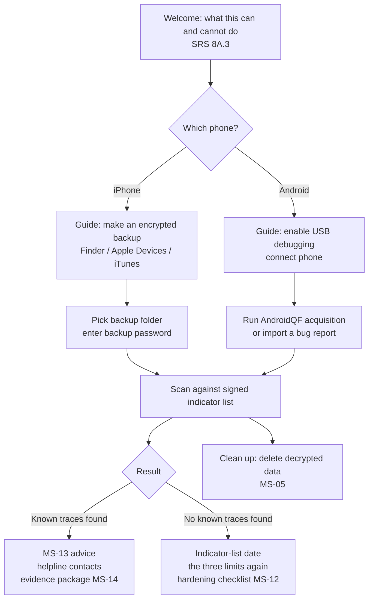
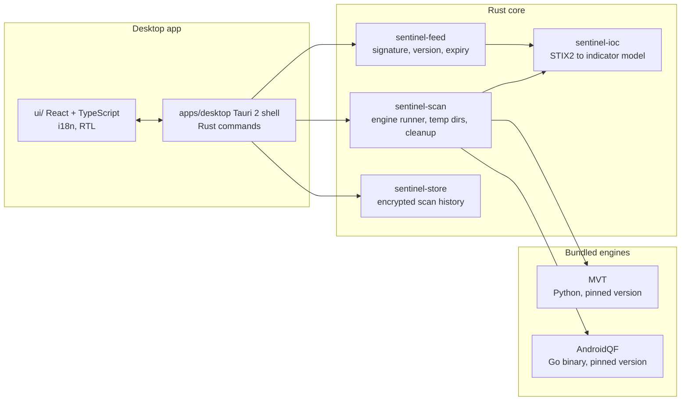

# Phase B — Sentinel Phone Check

Version 0.1 · Oct 2026 · Status: **Proposed**, to be refreshed at the Phase A gate · Part of [PLAN.md](PLAN.md)

A free desktop app for Windows, macOS and Linux that checks an iPhone or Android phone for traces of known state-grade spyware, from outside the phone. It wraps Amnesty International's open-source engines (MVT and AndroidQF) in a guided, bilingual (Arabic and English) interface and feeds them a signed, provenance-tracked indicator list.

This is SRS phase P1b ("Spyware Check") with the same gate. It covers what the Android app (Phase A) cannot: a check from outside a phone that may be fully compromised.

It reuses from Phase A: `sentinel-model`, `sentinel-ioc`, `sentinel-feed`, `sentinel-store`, `tools/feed-builder` and the signed feed itself. That makes it shorter than it would be as a first phase.

## 1. Scope

### In scope

| SRS ID | Requirement (short) |
| --- | --- |
| MS-04 | Guided phone check from a PC: iPhone encrypted backup, Android bug report or AndroidQF acquisition, using MVT and AndroidQF, fully offline |
| MS-05 | Backup password used in memory only, never stored; decrypted backup deleted after the scan |
| MS-10 | Signed indicator feed with provenance (source, date, report link) on every indicator; weekly and urgent updates; manual update from a file |
| MS-11 | High-risk mode, Phase B subset: weekly phone-check reminder, daily-restart reminder, helpline links |
| MS-12 | Hardening checklist with guided steps (iOS Lockdown Mode, Android Advanced Protection, updates, unused messaging apps) |
| MS-13 | On any match: do not wipe the phone yet, move sensitive conversations to another device, contact a helpline |
| MS-14 | User-initiated, encrypted evidence package that opens with standard tools |
| MS-15 | Result wording: "Known traces found" or "No known traces found" with the indicator-list date; never "clean" or "safe" |
| §8A.3 | The three limits shown before the first check and on every "No known traces found" result |
| §12.4, NF-14 | English and Arabic with RTL; WCAG 2.2 AA; keyboard and screen-reader use |
| §15.3 | Anti-abuse rules: checks only on a phone the user brings and unlocks, no remote anything, no content shown beyond matched records |
| NF-11 | No telemetry; the only network call is the optional feed update |

### Out of scope for Phase B

- Live monitoring of any kind (that is Phases B–D).
- Desktop self-check (MS-06, MS-07): moves to Phase D.
- Gateway matching and retro-hunt across network history (MS-01 to MS-03): Phase C.
- Checking a phone the user does not physically hold and unlock.

## 2. User flows

## 3. Architecture

Key points:

- The engines run as separate child processes. We never link them into our code, which keeps their licences separate from ours (see ADR-0004).
- Secrets are never passed on a command line, where other processes can read them. The B0 spike picks the safest channel MVT supports.
- All scan work happens in a private temporary directory that we delete in every exit path, including a crash on the next start.
- The indicator feed is the only network access, and it is optional. A feed file can also be imported by hand (SRS §14.3).

## 4. Indicator feed (MS-10)

Built in Phase A and shared by every edition. Summary:

| Item | Decision |
| --- | --- |
| Sources | Amnesty `mvt-indicators`, Citizen Lab `malware-indicators`, and others that pass the licence review in Phase A0 |
| Format | Bundle = manifest (version, created, expires, file hashes) + normalised indicators; each indicator keeps source, date and report link |
| Signing | Ed25519; private key kept offline, held by two maintainers; public key compiled into the app |
| Checks on load | Signature, monotonic version (no rollback), expiry (no freeze), per-file hash, provenance present on every indicator |
| Build | `tools/feed-builder` CLI. CI builds an unsigned candidate and a human-readable diff; a maintainer reviews and signs offline |
| Cadence | Weekly; urgent same-day update when a new public report appears |
| Hosting | GitHub Releases (free); app fetches over HTTPS; manual import from file for offline users |

## 5. Sprint plan

Two-week sprints, team of about 3. Each task names the SRS ID it serves. Tasks become GitHub issues. Detailed sprint planning is refreshed at the Phase A gate.

### B0 — Foundations (2 weeks)

- [ ] Licence review: MVT (MVT License 1.1), AndroidQF, Tauri plugins
- [ ] **Spike 1: MVT packaging.** Build a self-contained MVT for Windows, macOS and Linux (PyInstaller or a bundled standalone Python). Run `check-backup` and `check-androidqf` on MVT's own test artifacts on all three. Record results in an ADR.
- [ ] **Spike 2: password handling.** Find how to give MVT the backup password without a command-line argument or a file (MS-05).
- [ ] CI additions: pnpm workspace, UI lint and tests, desktop builds on Windows, macOS and Linux runners
- [ ] Phase B threat model (STRIDE): malicious backup input, temp-file leaks, UI spoofing of results
- [ ] Wireframes for every screen in §2, in Arabic and English
- [ ] Confirm helpline partners (Access Now Digital Security Helpline, SMEX) for the gate review

### Sprint 1 — App shell

- [ ] `apps/desktop` Tauri shell + `ui/` with routing, i18n (English and Arabic), RTL layout using CSS logical properties
- [ ] Welcome screen with the three limits (§8A.3)
- [ ] Feed download and verification through the Phase A `sentinel-feed` crate (MS-10)

### Sprint 2 — Scan engine

- [ ] `engines/`: pinned MVT and AndroidQF builds per OS, with checksums
- [ ] `sentinel-scan`: run MVT on an iPhone backup (decrypt, then check) and on AndroidQF output or a bug report; stream progress; parse MVT's JSON output into findings (MS-04)
- [ ] Private temp directory, disk-space check before decrypting (backups can be tens of GB), deletion on success, failure, cancel and next-start recovery (MS-05)
- [ ] Integration test: all public MVT test cases detected (Phase B gate)

### Sprint 3 — Guided flows and results

- [ ] iPhone flow: per-OS backup instructions, folder picker, password entry held in memory only (MS-04, MS-05)
- [ ] Android flow: USB-debugging guide, AndroidQF acquisition, bug-report import (MS-04)
- [ ] Results screen with exact MS-15 wording and the indicator-list date; limits repeated on every "No known traces found"
- [ ] MS-13 advice and helpline links on every match

### Sprint 4 — Evidence, history, hardening

- [ ] Evidence package: AES-256 encrypted ZIP with matched records, scan report and timeline; user-initiated only (MS-14)
- [ ] Encrypted scan history with the Phase A `sentinel-store` crate, key in the OS key store; one-click wipe (§13.2)
- [ ] Hardening checklist with guided steps (MS-12)
- [ ] High-risk mode subset: reminders and helpline links (MS-11)
- [ ] Feed update screen: check now, last update date, import from file (MS-10)

### Sprint 5 — Release readiness

- [ ] Packaging: MSI or NSIS (Windows), notarized DMG (macOS), AppImage and `.deb` (Linux)
- [ ] Code signing (see SUSTAINABILITY.md for free options for open-source projects)
- [ ] Accessibility pass: keyboard only, NVDA or Narrator, VoiceOver, Orca; high contrast
- [ ] Arabic copy review by native speakers; plain-language check (AL-02)
- [ ] Usability sessions: 8 users, at least half Arabic-first (§18.1)
- [ ] File-system audit after scans on all three OSes (MS-05)
- [ ] Helpline partner review (gate)
- [ ] Public beta release

## 6. Known technical risks and fallbacks

| Risk | Fallback |
| --- | --- |
| MVT on Windows is less tested than on Linux and macOS | Bundle our own standalone Python; if still blocked, ship Windows later and start with macOS and Linux |
| MVT needs the decrypted backup on disk, and deleting files on an SSD does not guarantee the data is gone | Decrypt into the private temp directory, delete in every exit path, and tell the user honestly; evaluate an encrypted scratch volume later |
| iPhone backups need Apple's software on Windows and macOS, and `libimobiledevice` on Linux | Guided per-OS instructions; detect missing prerequisites and explain them |
| Android acquisition needs USB debugging and, on some Windows PCs, vendor ADB drivers | Step-by-step guide with screenshots; bug-report import as a second path |
| New MVT versions change output formats | Pin engine versions; contract tests on MVT output; upgrade deliberately |

## 7. Definition of done for Phase B

- All public MVT test cases detected (SRS P1b gate).
- Runs with the network disconnected.
- No decrypted backup data remains after any scan path (file-system audit, MS-05).
- Feed signature, version, expiry and provenance checks have unit tests, plus a tampered-feed test that must fail.
- Every result screen passes the MS-15 and §8A.3 copy review in both languages.
- A helpline partner has reviewed the flow and wording.
- Anti-abuse checklist (SRS §15.3) signed off.
