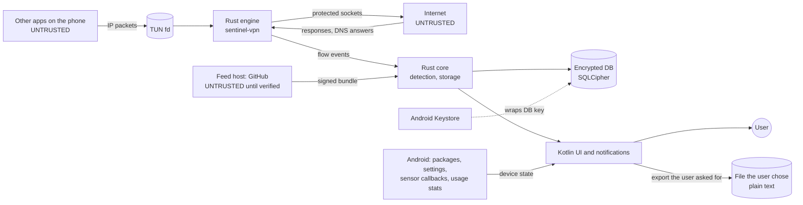

# Threat model: Phase A (Android)

Version 0.2 · 20 Oct 2026 · Method: STRIDE (SRS §15.4). Reviewed again at the Phase A gate and whenever a new data flow is added. Section 6 records the Sprint 10 review.

## 1. What we protect

| Asset | Why it matters |
| --- | --- |
| The local history: flows, DNS names, sensor use, alerts | It is a detailed record of the user's life. In the wrong hands it is itself surveillance (SRS §15) |
| The verdict shown to the user | A false "No known traces found" can endanger an at-risk user; a false alarm causes panic |
| The device's connectivity | The tunnel carries all traffic; a bug can cut the user off |
| The indicator feed and its signing keys | Whoever controls them controls what Sentinel detects |
| Users' trust | A security app that leaks or misleads does more harm than none |

## 2. Data flows and trust boundaries

Boundaries:

- **B1:** packets from apps into the engine.
- **B2:** responses from the network.
- **B3:** feed downloads.
- **B4:** other apps on the device, which may look at our UI, notifications or files.
- **B5:** someone with the unlocked phone in hand.
- **B6:** someone with the locked phone in hand, without its PIN.
- **B7:** what Android reports about the phone: installed packages, settings, sensor use. Apps can shape some of it (package names, components they declare).

## 3. Threats and mitigations

Status: **Done** = implemented and tested; **Open** = a gap with its planned fix; **Accepted** = a documented limit.

### Spoofing

| # | Threat | Mitigation | Status |
| --- | --- | --- | --- |
| S1 | A fake feed (DNS hijack, compromised mirror, malicious file) | DSSE envelope, Ed25519, trusted keys compiled in, threshold, payload type bound into the signature | Done (ADR-0005, 14 tests) |
| S2 | An app feeds fake DNS answers to make its traffic look like another domain | The DNS cache learns only from responses on upstream sockets we opened, never from packets an app sends into the tunnel | Done (by design in `relay.rs`) |
| S3 | An app puts a misleading server name (SNI) in its ClientHello | Every name shows its source: "Name from the connection itself (TLS server name)", or from a DNS answer; the address's network owner is shown alongside (DT-02, ADR-0010, ADR-0011) | Done |
| S4 | Another app shows notifications that imitate Sentinel's alerts | Alerts always also live inside the app; alert notifications only open the app (ADR-0012) | Done |
| S5 | Tapjacking over the VPN consent dialog | Android shows this dialog itself; we never draw over other apps | Accepted |
| S6 | An app names its package after a sharing service to pass as that service's own app, so its uploads there are not flagged (DL-06) | Only the package name is compared. The uploads still show as connections, and as new places (CM-04); indicators (ID-13) still apply | Accepted (ADR-0035) |
| S7 | Spyware installed as a system app (preinstalled, or by firmware) is not judged by DL-04, DL-05 and DL-06, which skip system apps to avoid false alarms | Indicators (ID-13), first network use and the hardening checklist still apply | Accepted |

### Tampering

| # | Threat | Mitigation | Status |
| --- | --- | --- | --- |
| T1 | Rollback to an older feed that lacks new indicators | Strictly increasing versions; installed version stored; an older list is refused (ADR-0019) | Done |
| T2 | A frozen feed: the attacker blocks updates | Expiry: an expired list is still used, but the main screen says since when it is out of date (MS-15, ADR-0019) | Done |
| T3 | A path-traversal bundle writes outside its folder | Only plain relative ASCII paths; symbolic links rejected | Done |
| T4 | Editing the local database to hide history | Database encrypted with a Keystore-wrapped key; SQLCipher authenticates every page, so a changed file fails to open and the app starts a new history (ADR-0009) | Done; the user is told (T6) |
| T5 | Someone holding the locked phone (B6) turns monitoring off from its notification. A stop the user asked for is not a gap, so nothing would show it | A stop is refused while the phone is locked; from Android 12 the Stop action asks to unlock first, and it then asks whether to stop (E6) | Done: the action's unlock request is tested on Android 14; the refusal is not tested on a device (the CI emulator has no PIN) |
| T6 | The history cannot be opened (the key is gone, or the file was changed) and a new one is started without a word: earlier connections and alerts are gone unnoticed | The new history opens with a Warning alert, "Sentinel's history was started anew", saying what is gone and why that happens | Done (tested on Android 14 with a history file overwritten) |

### Repudiation

| # | Threat | Mitigation | Status |
| --- | --- | --- | --- |
| R1 | "Sentinel blocked my app and nobody knows why" | Action journal with who, what, when and undo (SRS §9, ADR-0018) | Done |

### Information disclosure

| # | Threat | Mitigation | Status |
| --- | --- | --- | --- |
| I1 | Payloads leak through logs or the database | Payloads are never stored; only the first record is parsed for SNI, in memory | Done (engine) |
| I2 | Cloud backup copies the history off the phone | `android:allowBackup="false"` | Done |
| I3 | Another app reads our files | App-private no-backup storage plus SQLCipher with a random key wrapped by the Android Keystore (ADR-0009) | Done |
| I4 | Someone with the unlocked phone browses the history | One-tap wipe (deletes database and key); optional app lock (SRS §15.2) | Wipe done. The app lock is not in Phase A's plan: open, for the owner to schedule (review finding F4) |
| I5 | The feed download reveals that this person uses Sentinel | No identifiers sent (tested: the request names no phone); download is optional; import from a folder works offline (ADR-0019) | Done |
| I6 | Upstream connections from the engine reveal the device's real IP | Same as without Sentinel; we add no servers of our own | Accepted |
| I7 | Notifications on the lock screen tell whoever holds the phone what Sentinel found | Alert notifications are secret: on a locked phone they sound but show nothing (ADR-0012) | Done |
| I8 | An export holds the history in plain text | Only at the user's request, after a warning that the file is not encrypted; Android's document picker; no copy kept by Sentinel (ADR-0033) | Done |
| I9 | The monitoring notification and the VPN key icon show anyone who sees the phone that Sentinel runs | Required: no hidden mode (SRS §15.3) | Accepted |
| I10 | Sensor use, and the app guessed to be on screen, add to what the history tells about the user | Same protection as the history (I3); usage access is optional and every guess is labelled as one (ADR-0027) | Done |

### Denial of service

| # | Threat | Mitigation | Status |
| --- | --- | --- | --- |
| D1 | Engine crash or hang cuts the phone off | Android routes outside the tunnel when the service dies; the gap is recorded and shown (NF-07, SP-03), including a process that was killed or crashed (ADR-0008). An engine that hangs misses its heartbeat: after 30 s its gap is recorded from its last report and a new engine replaces it ([ADR-0029](adr/0029-heartbeat.md)) | Done; replacing a hung engine is not tested on a device |
| D2 | An app opens thousands of flows, or uploads faster than the upstream, to exhaust memory | Bounded DNS cache; idle timeouts; fixed 32 KiB TCP buffers with real flow control (smoltcp), checked by the lab's backpressure test; bounded UDP queues; at most 1024 open flows in total and 512 per app, refused flows not recorded, a Warning about the app ([ADR-0028](adr/0028-flow-limits.md)) | Done; tuning the limits on the reference phones is open (Sprint 9) |
| D3 | Malformed packets crash the parsers | Bounds-checked SNI parser, tested with truncated, corrupted and random input; DNS parsing through `simple-dns`; coverage-guided fuzzing of the TLS and DNS parsers and of the names the detection rules read, weekly in CI ([ADR-0036](adr/0036-fuzzing.md)) | Done; QUIC is not parsed |
| D4 | Another VPN app takes the tunnel (always-on VPN) | `onRevoke` records a monitoring gap, shown on the main screen, with its Warning alert (ADR-0012) | Done |
| D5 | Battery drain makes users uninstall | Idle wake-ups measured in CI (ADR-0006) | Done on the host; measuring on the reference phones is open (Sprint 9) |
| D6 | The phone maker's battery management stops the service | The heartbeat and gaps make every stop visible; "Keep monitoring running" gives Android's and the maker's steps (ADR-0029, ADR-0030) | Done; the makers' steps are not checked on their phones |
| D7 | After a crash or a kill, the service is not started again. Monitoring stays off until the user opens Sentinel, unless always-on VPN is set; the gap is recorded only then | While monitoring runs, the service is sticky: Android starts it again after its process dies, and the gap closes once monitoring runs. When Android leaves the service without a process, a job armed at every heartbeat check starts it. The third stop within 24 hours raises a Critical alert offering the steps that keep monitoring running (SP-02, [ADR-0038](adr/0038-restart-after-a-crash.md)) | Done; a maker that blocks restarts is covered by those steps and always-on VPN |

### Elevation of privilege

| # | Threat | Mitigation | Status |
| --- | --- | --- | --- |
| E1 | Another app binds to, starts or stops our VpnService | Service not exported and protected by `BIND_VPN_SERVICE`; only the main activity is exported | Done |
| E2 | A malicious feed entry triggers an automatic action | Feed carries data only; automatic actions are off by default (SRS §9) | Done (design) |
| E3 | Memory-safety bugs in native code | Rust everywhere; `unsafe` denied workspace-wide except reviewed lines with SAFETY comments | Done |
| E4 | Another app opens Sentinel's main activity, the one exported, with an alert to show | It can only show an alert inside Sentinel; nothing is changed without the user. Sentinel's notifications use immutable intents | Accepted |
| E5 | Another app sends Sentinel broadcasts it listens to | Receivers are registered at run time for Android's own broadcasts, not exported from Android 13 on | Done |
| E6 | An app with notification access fires the monitoring notification's Stop action itself (`PendingIntent.send()`), without a tap and without unlocking. Monitoring stops, and a stop the user asked for leaves no gap | The action opens a question in Sentinel, on a screen no other app can open, instead of reaching the service. Only the answer "Stop monitoring" stops it | Done (audit finding A-02): on Android 14, firing the action opens the question and monitoring runs on until the answer; also shown in Arabic, right to left |

## 4. Accepted limits (shown to users, SRS §19.1)

- Spyware with full control of the phone can hide from any app on that phone. Phase B adds a check from outside.
- Encrypted payloads are never visible; ECH and in-app encrypted DNS hide some names.
- A user with root, or with physical access while the phone is unlocked, can switch Sentinel off.
- Apps that came with the phone are trusted more: their regular check-ins, DNS use and uploads to sharing sites are not flagged (S7).

## 5. Review triggers

Update this model when: a new data source or network call is added; the feed format changes; a phase gate is reached; a security report arrives (SECURITY.md).

## 6. Review, Sprint 10 (20 Oct 2026)

Every row was checked against the code and its tests as of PR #11, and the data flows added since A0 were added to the model:
- sensor callbacks and usage stats (SE-01, ADR-0027);
- installed packages, special access and device settings (ID-03, ID-10, ID-12, ID-13);
- notifications;
- the export (§12.3).

**Statuses brought up to date:** S3, S4, T1, T2, R1, I5 and D4 were done in Sprints 4 to 7 but still read as planned.

**Findings:**

| # | Finding | Action |
| --- | --- | --- |
| F1 | Monitoring could be stopped from the notification on a locked phone, leaving no gap (T5) | Fixed in this review |
| F2 | A history that cannot be opened is replaced without telling the user (T6). A0 planned the notice for Sprint 5 | Fixed in this review: an alert in the new history |
| F3 | The service is not restarted after a crash or kill, and repeated stops raise no Critical alert (D7, SP-02) | Fixed after this review (ADR-0038): restarted by Android, tested by killing the process on the emulator; a Critical alert at the third stop within a day |
| F4 | The optional app lock (SRS §15.2, I4) was planned for Sprint 10 in A0 but is not in Phase A's plan | For the owner: schedule it, or accept it for Phase A |

**Still needed before the public beta** (SRS §15.4):
- an external security audit;
- reproducible builds and an SBOM for each release;
- the maintainers' feed signing keys, made and kept offline.

