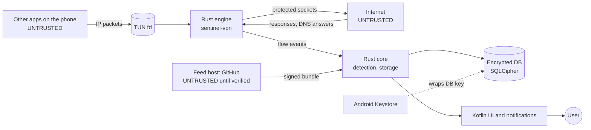

# Threat model: Phase A (Android)

Version 0.1 · Oct 2026 · Method: STRIDE (SRS §15.4). Reviewed again at the Phase A gate and whenever a new data flow is added.

## 1. What we protect

| Asset | Why it matters |
| --- | --- |
| The local history: flows, DNS names, sensor use, alerts | It is a detailed record of the user's life. In the wrong hands it is itself surveillance (SRS §15) |
| The verdict shown to the user | A false "No known traces found" can endanger an at-risk user; a false alarm causes panic |
| The device's connectivity | The tunnel carries all traffic; a bug can cut the user off |
| The indicator feed and its signing keys | Whoever controls them controls what Sentinel detects |
| Users' trust | A security app that leaks or misleads does more harm than none |

## 2. Data flows and trust boundaries

Boundaries:

- **B1:** packets from apps into the engine.
- **B2:** responses from the network.
- **B3:** feed downloads.
- **B4:** other apps on the device, which may look at our UI, notifications or files.
- **B5:** someone with the unlocked phone in hand.

## 3. Threats and mitigations

Status: **Done** = implemented and tested in A0; **Sprint N** = planned; **Accepted** = a documented limit.

### Spoofing

| # | Threat | Mitigation | Status |
| --- | --- | --- | --- |
| S1 | A fake feed (DNS hijack, compromised mirror, malicious file) | DSSE envelope, Ed25519, trusted keys compiled in, threshold, payload type bound into the signature | Done (ADR-0005, 14 tests) |
| S2 | An app feeds fake DNS answers to make its traffic look like another domain | The DNS cache learns only from responses on upstream sockets we opened, never from packets an app sends into the tunnel | Done (by design in `relay.rs`) |
| S3 | An app puts a misleading server name (SNI) in its ClientHello | The SNI is shown as "claimed by the app"; the DNS name and IP owner are shown alongside it; DT-02 shows the source of every field | Sprint 4 |
| S4 | Another app shows notifications that imitate Sentinel's alerts | Alerts always also live inside the app; notifications never ask for actions outside the app | Sprint 5 |
| S5 | Tapjacking over the VPN consent dialog | Android shows this dialog itself; we never draw over other apps | Accepted |

### Tampering

| # | Threat | Mitigation | Status |
| --- | --- | --- | --- |
| T1 | Rollback to an older feed that lacks new indicators | Strictly increasing versions; installed version stored | Done (feed); storing the version is Sprint 7 |
| T2 | A frozen feed: the attacker blocks updates | Expiry: an expired list is still used, but flagged to the user (MS-15) | Done (feed); UI is Sprint 7 |
| T3 | A path-traversal bundle writes outside its folder | Only plain relative ASCII paths; symbolic links rejected | Done |
| T4 | Editing the local database to hide history | Database encrypted with a Keystore-wrapped key; changes made outside the app are detected at start | Sprint 2 |

### Repudiation

| # | Threat | Mitigation | Status |
| --- | --- | --- | --- |
| R1 | "Sentinel blocked my app and nobody knows why" | Action journal with who, what, when and undo (SRS §9) | Sprint 6 |

### Information disclosure

| # | Threat | Mitigation | Status |
| --- | --- | --- | --- |
| I1 | Payloads leak through logs or the database | Payloads are never stored; only the first record is parsed for SNI, in memory | Done (engine) |
| I2 | Cloud backup copies the history off the phone | `android:allowBackup="false"` | Done |
| I3 | Another app reads our files | App-private storage plus SQLCipher | Sprint 2 |
| I4 | Someone with the unlocked phone browses the history | Optional app lock (biometric or PIN), one-tap wipe | Sprint 10 (lock), Sprint 2 (wipe) |
| I5 | The feed download reveals that this person uses Sentinel | No identifiers sent; download is optional; manual import from a file works offline | Done (design); UI is Sprint 7 |
| I6 | Upstream connections from the engine reveal the device's real IP | Same as without Sentinel; we add no servers of our own | Accepted |

### Denial of service

| # | Threat | Mitigation | Status |
| --- | --- | --- | --- |
| D1 | Engine crash cuts the phone off | Android routes outside the tunnel when the service dies; the gap is recorded and shown (NF-07, SP-03) | Done (fail-open by design); gap recording is Sprint 1 |
| D2 | An app opens thousands of flows to exhaust memory | Bounded DNS cache; idle timeouts; bound ipstack's channels | Partly done; channels are Sprint 9 |
| D3 | Malformed packets crash the parsers | Bounds-checked SNI parser, tested with truncated, corrupted and random input; DNS parsing through `simple-dns`; fuzzing | Done (unit tests); fuzzing is Sprint 10 |
| D4 | Another VPN app takes the tunnel (always-on VPN) | Detected as a monitoring gap and shown to the user | Sprint 1 |
| D5 | Battery drain makes users uninstall | Idle wake-ups measured in CI (ADR-0006) | Done (host); phone is Sprint 1 |

### Elevation of privilege

| # | Threat | Mitigation | Status |
| --- | --- | --- | --- |
| E1 | Another app binds to our VpnService | Service protected by `BIND_VPN_SERVICE`; only the main activity is exported | Sprint 1 |
| E2 | A malicious feed entry triggers an automatic action | Feed carries data only; automatic actions are off by default (SRS §9) | Done (design) |
| E3 | Memory-safety bugs in native code | Rust everywhere; `unsafe` denied workspace-wide except reviewed lines with SAFETY comments | Done |

## 4. Accepted limits (shown to users, SRS §19.1)

- Spyware with full control of the phone can hide from any app on that phone. Phase B adds a check from outside.
- Encrypted payloads are never visible; ECH and in-app encrypted DNS hide some names.
- A user with root, or with physical access while the phone is unlocked, can switch Sentinel off.

## 5. Review triggers

Update this model when: a new data source or network call is added; the feed format changes; a phase gate is reached; a security report arrives (SECURITY.md).
